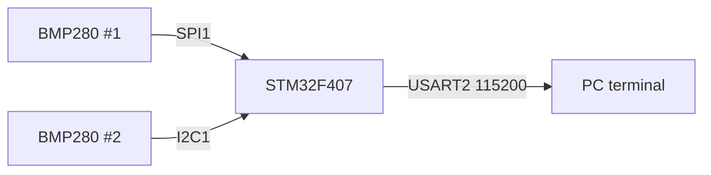

# BMP280 Dual Sensor Driver (SPI + I²C)


-orange)


Register-level drivers for reading **two BMP280 temperature/pressure sensors at the same time** — one on **SPI1** and one on **I²C1** — on an STM32F407 Discovery board. No HAL or LL: every peripheral (GPIO, SPI, I²C, USART) is configured by writing registers directly. Results are printed over UART.

> Developed for the EEE316 Microprocessors course (Lab 4).

## Features

- **SPI1 driver** (mode 0, ~1 MHz, software chip select) with single-register write and burst read
- **I²C1 driver** (100 kHz standard mode) with a **timeout on every wait loop**, so a missing or stuck sensor reports an error instead of freezing the program
- **BMP280 compensation** in 32-bit integer math (datasheet algorithm, using the factory calibration words at `0x88–0x9F`)
- **Minimal UART driver** with integer printing (no `printf`)

## Hardware

| Part | Notes |
|---|---|
| STM32F407G-DISC1 | Runs on the default 16 MHz HSI clock |
| 2 × BMP280 breakout | One wired for SPI, one for I²C (address `0x76`, SDO → GND) |
| USB–TTL serial adapter | 115200 baud, 8N1 |

### Wiring

| Signal | STM32 pin | Connects to |
|---|---|---|
| SPI1_SCK | PA5 | BMP280 #1 SCK |
| SPI1_MISO | PA6 | BMP280 #1 SDO |
| SPI1_MOSI | PA7 | BMP280 #1 SDI |
| CS (GPIO) | PA4 | BMP280 #1 CSB |
| I2C1_SCL | PB6 | BMP280 #2 SCL (open-drain, internal pull-up) |
| I2C1_SDA | PB7 | BMP280 #2 SDA (open-drain, internal pull-up) |
| USART2_TX | PA2 | USB–TTL RX |
| GND | GND | All modules |



<!-- Photo of the setup: add docs/setup.jpg and reference it here -->

## How it works

1. Both sensors are put into **normal mode** with ×1 oversampling (`ctrl_meas = 0x27`, `config = 0x00`).
2. The 24 calibration bytes are burst-read once at start-up.
3. In the main loop, the 6 raw data bytes (`0xF7–0xFC`) are burst-read from each sensor and converted to °C (0.01 resolution) and Pa.
4. Each reading is printed; an I²C failure prints an error line and the loop continues.

Output format:

```
[SPI SENSOR] Temp: <°C> C | Pressure: <Pa> Pa
[I2C SENSOR] Temp: <°C> C | Pressure: <Pa> Pa
```

## Build and flash

Requires the [Arm GNU Toolchain](https://developer.arm.com/downloads/-/arm-gnu-toolchain-downloads) (`arm-none-eabi-gcc`) and GNU Make.

```bash
make            # -> build/BMP280_Dual_Sensor_Driver.elf / .bin
make flash      # uses st-flash (stlink tools); the Discovery board has an on-board ST-LINK
```

Alternatively, flash `build/BMP280_Dual_Sensor_Driver.elf` with STM32CubeProgrammer, or create an empty STM32F407VG project in STM32CubeIDE and add `Core/` and `Drivers/`.

## Project layout

```
Core/Src/main.c                           drivers + application (all register-level code)
Core/Src/system_stm32f4xx.c, Core/Startup  CMSIS start-up code
Drivers/CMSIS/                            CMSIS core and device headers (register definitions)
STM32F407VGTX_FLASH.ld                    linker script
```

## Known limitations

- Calibration words are read only from the SPI sensor and used for both sensors; the I²C sensor should read its own.
- Delays are busy-wait loops, not timer based.

---

### 🇹🇷 Türkçe özet

STM32F407 Discovery üzerinde iki BMP280 sensörünü aynı anda — biri **SPI1**, diğeri **I²C1** üzerinden — okuyan, HAL kullanmadan register düzeyinde yazılmış sürücüler. I²C beklemeleri zaman aşımı korumalı; kalibrasyon ve dengeleme datasheet'teki tamsayı algoritmasıyla yapılıyor; sonuçlar USART2 (PA2, 115200) üzerinden terminale basılıyor. EEE316 Mikroişlemciler dersi Lab 4 kapsamında geliştirildi.
